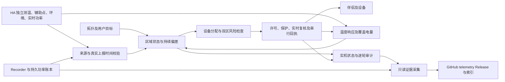
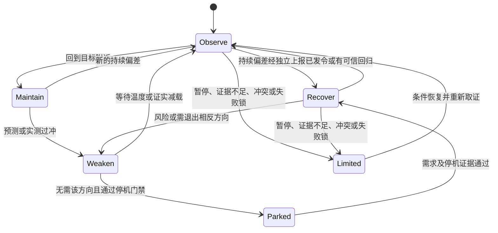
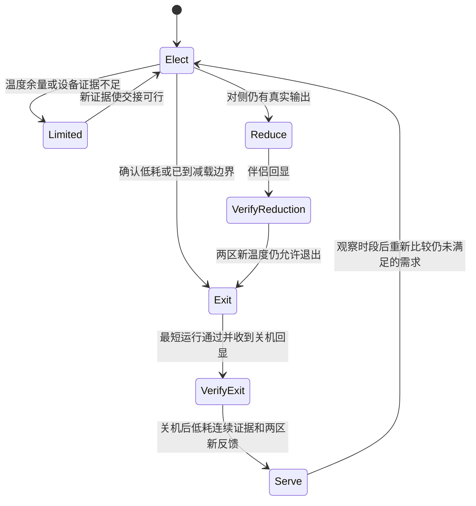

# 区域闭环恒温与证据归档

## 运行结构

执行账本单独保存 `prepared → accepted → proxy_echo`。不明确的传输结果进入失败锁。确认开机后按当前目标处理 `initial`；目标、观测定义或需求变化时丢弃未发送意图，必要时仅做安全归位。关闭后在 `parked` 保留模式停机证据，下一次恢复重新计算。回显代表伴侣确认，温度与功率作为单独的观测证据。

### 设备回报与账本不一致

长期暂停调度只认明确入口：虚拟恒温器离开 `auto`、区域 `pause_entity`、许可 `paused_zones` 或 `isolated_rooms`。伴侣回报的模式、设温或风速与最近确认的基线不同，且没有在途指令时，不再写入永久 `manual_holds`，按下面两种情况处理：

- **开机未生效**：最近一条已回显的模式指令是这次开机，回显后 `start_power_grace_seconds`（240 秒）到 `start_verify_seconds`（900 秒）之间状态从该模式退回 `off`，且发令后的新鲜功率报告（120 秒内、0–10000 W）峰值 `peak_watts` 低于运行阈值（同一功率实体的 `verified_off_power.ceiling_w` 的 2 倍，至少 30 W）。记入 `start_failures`，按当时模式补回 `parked`，结束该机未完成的换向批次。同一条开机指令只计一次。重试间隔从 `start_retry_backoff_seconds` 起逐次翻倍；超过 `start_retry_limit` 次后暂停重试 `start_failure_hold_seconds`，到期再试；距上次失败超过 `start_failure_reset_seconds`（1 天）则重新计数。回显后 240 秒内就退回 `off` 视为有人关机，按外部调整处理。开机后实测功率达到运行阈值即清除失败计数。发令后没有新鲜功率报告时不判定为开机失败，按外部调整处理。
- **其他外部调整**：采纳新状态为基线，写入 `external_overrides`，让出调度 `external_override_seconds`。期间再次变化会重新计时，到期自动恢复。外部关机按原运行模式补回 `parked`，此后仍受最短停机、低耗证据和反向保护约束。外部开到制冷或制热会清除该机的 `start_failures`。
- **停机状态下的属性刷新**：基线和回报都是 `off`、只有设温或风速变化时，只采纳为新基线，不让出调度，也不改写已有的 `parked`。

早期版本自动写入的「检测到外部修改了空调设置，已暂停该机」会在伴侣回报有效状态后解除并采纳当前状态；回报为 `unavailable`／`unknown` 时继续保留到下一轮。运维手写的其他 `manual_holds` 原样保留。状态包导出 `external_overrides` 与 `start_failures`，脱敏审计保留上述事件的主要字段。

## 区域与设备配置

从 `home-assistant/shadow/topology.example.json` 建立本地 `topology.json`。`rooms.json` 继续绑定已有设备、硬件软限及调试见证。`sensors` 支持 `primary`、`auxiliary`、`constraint` 和 `environment`，显式禁用的点无需存在。每个区域具有独立主点，`primary` 直接使用主点，`weighted` 按配置把新鲜辅助点加入融合，独立证据仍采用主点的上报时间。`constraint` 独立保护危险边界，环境点使用配置的温度属性。

`zones.target` 可映射某台虚拟恒温器、指定 HA 数值实体及可选属性，或设静态目标。`pause_entity` 可接绑定的 `input_boolean`。许可的 `paused_zones` 暂停一个区域，`isolated_rooms` 和伴侣手动状态限制对应设备。暂停区域仍保留温度约束。`actuators.influences` 显式描述设备可作用的多个区域。`connections` 记录区域耦合，`opposite_operation.enabled` 默认关闭。开启后还要求明确分区、低跨区影响、真实输出证据以及对侧匹配需求。新增室内主点后建立新区域，修改设备影响关系并提升 `observation_version`。变更定义、实际来源或目标会废弃受影响的暂态证据；设备基线及发令历史照常继承。

## 策略与保护

初始跟踪带为 ±0.3℃。区域偏差、持续时间和独立上报共同资格化，轻重偏差保持同一段记录。偏差持续至少 20 分钟并有跨 10 分钟的独立报告时可以恢复，可信趋势已在回归时暂缓。加强后使用本区新温度和阶段等待，邻区以新鲜值和风险边界约束，单台暂停不会消除该区域。设备短运行、停机、反向保护和数据新鲜度独立记录。停机重启继续要求连续低耗的实测报告，报告断流仍以 120 秒为限。

维持阶段保留有效设温。稳态温度和真实活动时段共同资格化维持 setpoint，恢复先用当前目标或同观测定义下的可靠维持值。修正受硬件范围、模式软限及步长限制。对无方向需求的有效反向负荷先减载，满足停机保护后允许让已经验证低荷的相反模式退出。两区域都需要相反方向时先按区域风险、偏差和等待排序；无法满足的需求保留在审计中。总电量依据真实报告之间的有覆盖积分。排序只有在至少两种方案各积累足够可比、成功的响应与电量样本后才比较 Wh/温度改善；覆盖不足继续依照区域与作用范围分配。

`zone_control.py` 产生状态、候选和区域作用范围。`continuous_pilot.py` 把同一决策写入状态输出和逐轮日志，用第二次 HA 观测复核后再串行执行。`live_evidence.py` 合并真上报与同源同代账本，避免分钟状态等待遮断实时功率。`service.py` 保留历史功率模型和 SQLite 分钟观测，可用 `shadow-health.json` 和状态 `published_at`／`stale_after` 查看更新时间。

## 部署与回退

运行全量单测、`work/verify_*.py` 和历史逻辑回放。使用 `work/release_local.py --production <home-assistant> --commit <完整远端 main SHA> --topology <私有配置>`。脚本备份旧源码、有效配置、Compose 和状态证据。在途指令结算后停服，按 Git 对象部署，启用 32 MiB `/tmp`，恢复旧运行时可用同脚本的 `--rollback <备份路径>`。回退只处理源码、配置和 Compose，运行中新产生的账本、回执和 SQLite 历史继续使用。

## 每小时证据

`work/install_telemetry.py` 在 macOS 安装 `local.codex.home-assistant.thermostat-telemetry`。每小时第 5 分钟运行，时间窗用 UTC 计算并映射北京时间。安装后从同一入口立即上传状态包。该用户服务随 Docker Desktop 登录环境运行，睡眠或关机漏跑后以游标补齐。任务状态和日志位于 `~/Library/Application Support/HomeAssistantThermostat/telemetry/`。停止可执行 `launchctl bootout gui/$(id -u)/local.codex.home-assistant.thermostat-telemetry`，并用 `launchctl disable` 持久停用。

采集器只读，独立 SQLite 查询事务包含已提交的 WAL，跨库分别记录采集时刻和水位。游标在下载验证 ZIP、逐文件 SHA 和远端索引完成后推进。失败在队列留下包和窗口，使用互斥锁、限时及有限退避。最近已上传窗口重新对账接收晚到的数据；修订作为不同附件链接。状态包与小时包的范围在 manifest 明列。索引分别列出采集时提交与观测窗口内的版本，补传旧窗口保留其真实部署归属。只在确认上传后清理本地任务副本。GitHub 用 `telemetry-` 日期预发布件及 `telemetry-index.json` 索引，遇不可变 Release 使用独立日期窗口附件。认证由安装用户已有 GitHub CLI 凭据提供，白名单及本地 HMAC 对来源、设备和区域匿名化。首包及小时包均不以短窗口推断长期节电或恒温改善。

## 双向需求的交接

每区保留本身的持续恢复证据。两区同时合格且已有相反输出时，调度器先检查可操作设备和双方温度余量。一次只选一侧，已获得起机或加码回响的一侧拥有有限观察时段。仍有合格需求的另一侧在舒适保护允许时接下一轮，额外加码不会延长公平时段。跨区执行器受本区需求约束。无法安全分配时，保留双方的未满足需求和各自受限原因。

发令前按当前需求、证据与同一交接阶段再检查。未发计划随条件变化作废，`prepared`、`accepted`、`proxy_echo` 与设备基线保留。交接的 `off` 会进入已有停机保护。反馈尚不明确时禁止以另一台设备绕过故障保护。

恢复已合格的区域短暂进入 ±0.3℃ 时暂停加码，并继续保存原恢复方向与起点。两次独立带内报告至少相隔 10 分钟，趋势未明显外移时才确认完成。单次触线后回落仍服从动作后等待和真实新报告。目标、观测源、暂停变化和真实断流需要重新取证。

区域观测签名只包含实际依赖。设备计划另含受影响区域、作用范围与锁，学习另含使用的环境定义。禁用或未被使用的测点不触发清空，改变某区有效观测时可保留其他区域的历史。部署升级时可验证来源的旧观察和学习会迁移，历史回执继续沿用原记录。

## 摘要修订与故障采集

定时器从本地已验证包补传，然后独立探测当前容器。停止、哈希不一致和缺少本进程启动记录均输出结构化故障，可读账本、Recorder 和已有证据继续进入归档。采集时版本不明时固定索引显示 `unknown` 或 `mismatch`，历史窗口仍按当时的 `startup` 和有效配置切分。

摘要修订版 2 按全量审计事件分别计算窗口、部署段和滚动 24 小时异常，并校核分段计数相加。没有功率覆盖时电量为 `null`，审计缺口时总异常数为 `null` 并保留已观察事件。旧附件继续可下载，修订附件通过 `supersedes` 链接旧包和校验值。
